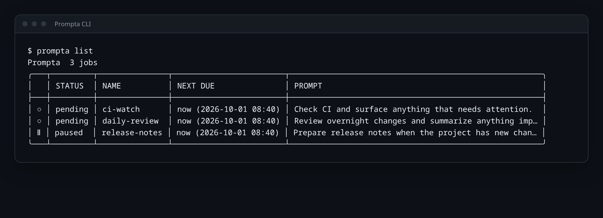
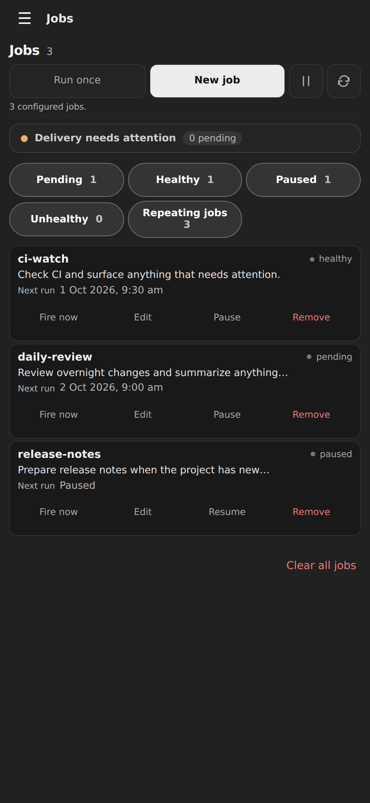

# Prompta

Prompta schedules one-off and recurring ChatGPT prompts. Each scheduled run starts a fresh chat. The web UI manages jobs and locally recorded sends. In production (`PROMPTA_FIRE_AND_FORGET=1`), it sends once and never reads ChatGPT responses or history, checks completion, or sends replies; tabs remain open for ChatGPT generation until idle cleanup.

<p align="center">
  
</p>

<p align="center">
  
</p>

## Setup

Install Python 3.11+, uv, Bun, and Brave at `/opt/brave-bin/brave`.

```bash
git clone https://github.com/brandonp2412/Prompta.git ~/prompta
cd ~/prompta
uv sync --locked
bun install --frozen-lockfile
bun run build

mkdir -p ~/.config/systemd/user
cp systemd/prompta-*.service systemd/prompta-*.timer systemd/prompta.target ~/.config/systemd/user/
systemctl --user daemon-reload
systemctl --user enable --now prompta.target prompta-browser-watchdog.timer prompta-manual-reply-worker.service
```

Open `http://127.0.0.1:8765` for Jobs and Chats.

## ChatGPT login

Stop the background browser and open its profile visibly:

```bash
systemctl --user stop prompta-browser.service
/opt/brave-bin/brave \
  --user-data-dir="$HOME/.local/state/prompta/chrome-profile" \
  --profile-directory=Default \
  --password-store=basic \
  --remote-debugging-port=9222 \
  https://chatgpt.com
```

Sign in, close the window, then run `systemctl --user start prompta-browser.service`.

## CLI

```bash
uv run prompta add nightly-review "Review the project and improve it" --daily-at 21:00
uv run prompta edit nightly-review "Review the project and fix the highest-priority issue"
uv run prompta list
uv run prompta once "Run this immediately in a fresh chat"
uv run prompta once --pin "Run this and pin the new chat"
uv run prompta at 21:30 one-shot "Run once at 9:30pm" --pin
uv run prompta once --job nightly-review
```

Firing an interval job restarts its countdown from the manual trigger time.

## Deployment

After committing and pushing `main`, run `python -m scripts.deploy_release` from Glass.
This builds the UI, packages it with the backend, uploads the release to Nox, and runs
`scripts.deploy_guarded` there. Deployment records live work, kills application workers,
starts the new release, and resumes exact-chat recovery. The browser service stays running.
Recovering chats retain their concurrency slots until completion or 15 minutes without
a successful verified recovery read. Verified generation and new response content
also refresh the idle deadline. Failed startup leaves admissions paused.

[Configuration](docs/configuration.md) · [Architecture](docs/service-architecture.md) · [Development](CONTRIBUTING.md) · [Upstreams](docs/upstreams.md)
