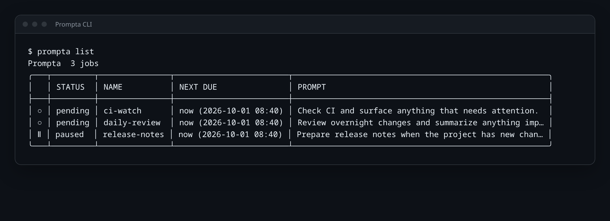
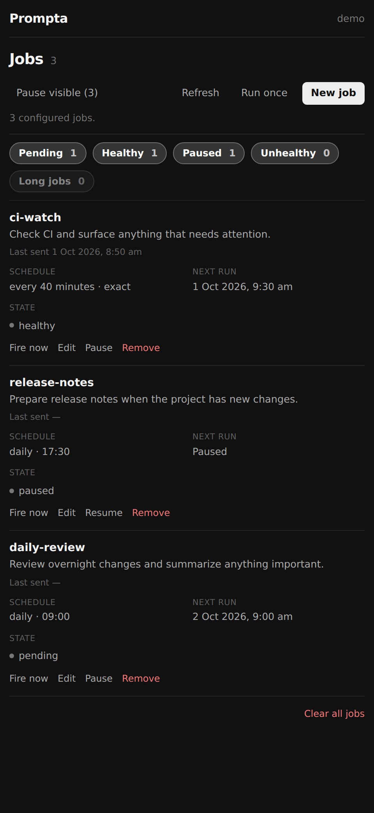

# Prompta

Prompta schedules one-off and recurring prompts for ChatGPT. Each run opens a fresh chat and passively captures the assistant's response from its owned tab. The mobile-friendly web UI manages jobs and shows local read-only results, without accessing account-wide ChatGPT history.

<p align="center">
  
</p>

<p align="center">
  
</p>

## Run

```bash
git clone https://github.com/brandonp2412/Prompta.git ~/prompta
cd ~/prompta
uv sync --locked
bun install --frozen-lockfile
bun run build

mkdir -p ~/.config/systemd/user
cp systemd/prompta-*.service systemd/prompta-*.timer systemd/prompta.target ~/.config/systemd/user/
systemctl --user daemon-reload
systemctl --user enable --now prompta.target prompta-browser-watchdog.timer
```

The Jobs and Chats UI is at `http://127.0.0.1:8765`. Its Chats view reads only Prompta's private local SQLite results. The CLI is available as `uv run prompta`, for example:

```bash
uv run prompta add nightly-review "Review the project and improve it" --daily-at 21:00
uv run prompta edit nightly-review "Review the project, improve it, and update the ledger"
uv run prompta list
uv run prompta once "Run this immediately in a fresh chat"
uv run prompta once --job nightly-review  # fire an existing job and restart its interval
```

## Working hours

To prevent Prompta from starting ChatGPT delivery work outside a local-time window, create
`~/.config/prompta/config.toml`:

```toml
[working_hours]
enabled = true
start = "22:30"
end = "08:00"
timezone = "Pacific/Auckland"
```

The start time is inclusive and the end time is exclusive. Overnight windows are supported.
Scheduled jobs remain durable while delivery is blocked and resume when the window opens.
Explicit `once` and UI **Fire now** sends bypass the working-hours window, but still obey
account backoff, resource constraints, and the global send gap. Firing an interval job
restarts its countdown from the manual trigger time, replacing any pending scheduled
send that has not started. Already-running sends cannot be interrupted. Fixed-time
daily and one-time schedules are unchanged. An ad-hoc `once` prompt has no schedule
to reset. If
`working_hours` is omitted or disabled, Prompta can deliver at any time.

## Login to ChatGPT

Prompta uses a dedicated Chromium profile. Stop the background browser, open that same profile visibly, and log in at ChatGPT:

```bash
systemctl --user stop prompta-browser.service

/opt/brave-bin/brave \
  --user-data-dir="$HOME/.local/state/prompta/chrome-profile" \
  --profile-directory=Default \
  --password-store=basic \
  --remote-debugging-port=9222 \
  https://chatgpt.com
```

After login, close that browser window and start Prompta's browser again:

```bash
systemctl --user start prompta-browser.service
```

## Connector permissions

Passive response capture retains each Prompta-owned tab only until completion, interruption, or the existing hard 45-minute TTL. To automatically select “Always allow” on successive permission dialogs within that bound, add to `~/.config/prompta/config.toml`:

```toml
[connector_approval]
enabled = true
```

Restart `prompta-delivery-worker` after changing this setting. Delivery is acknowledged immediately; approval handling and passive response capture run in the background without making any additional ChatGPT requests.
